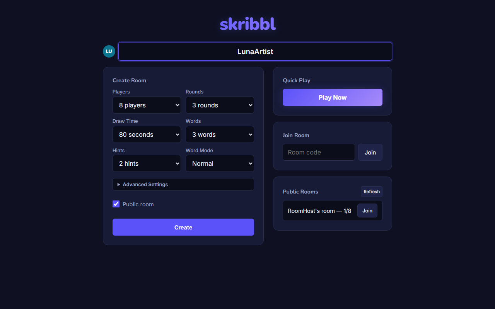
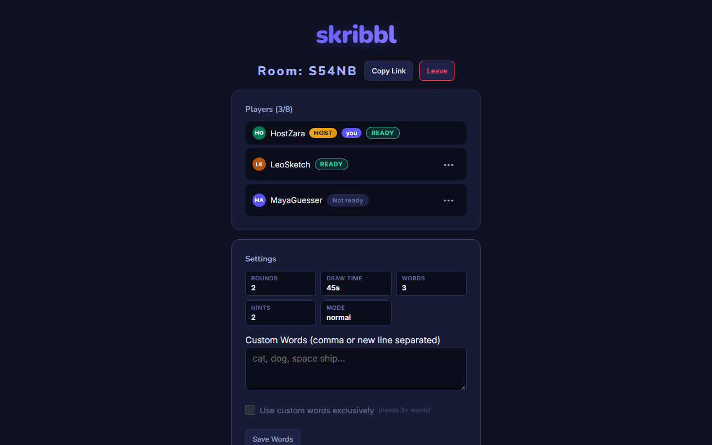
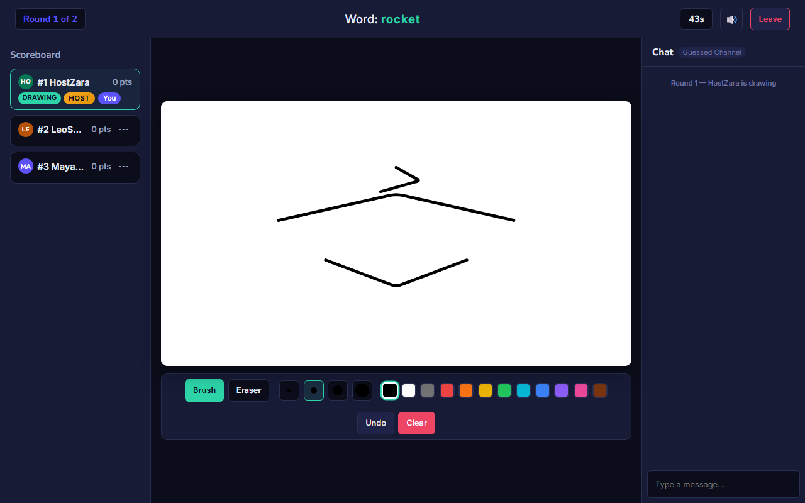
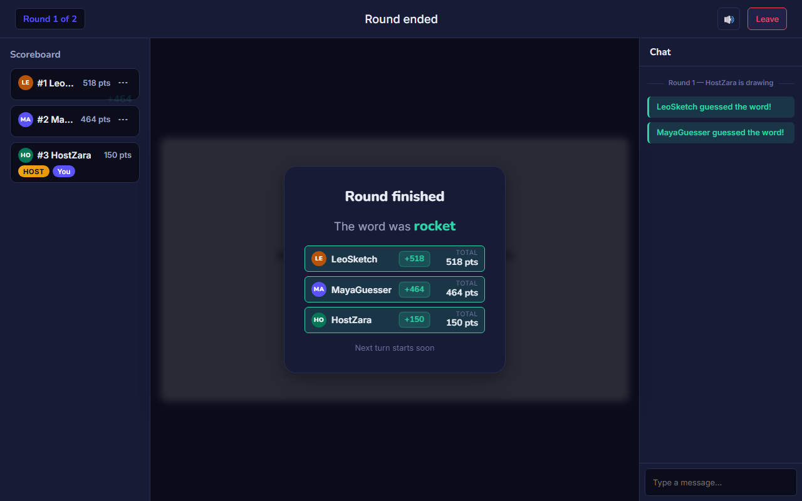
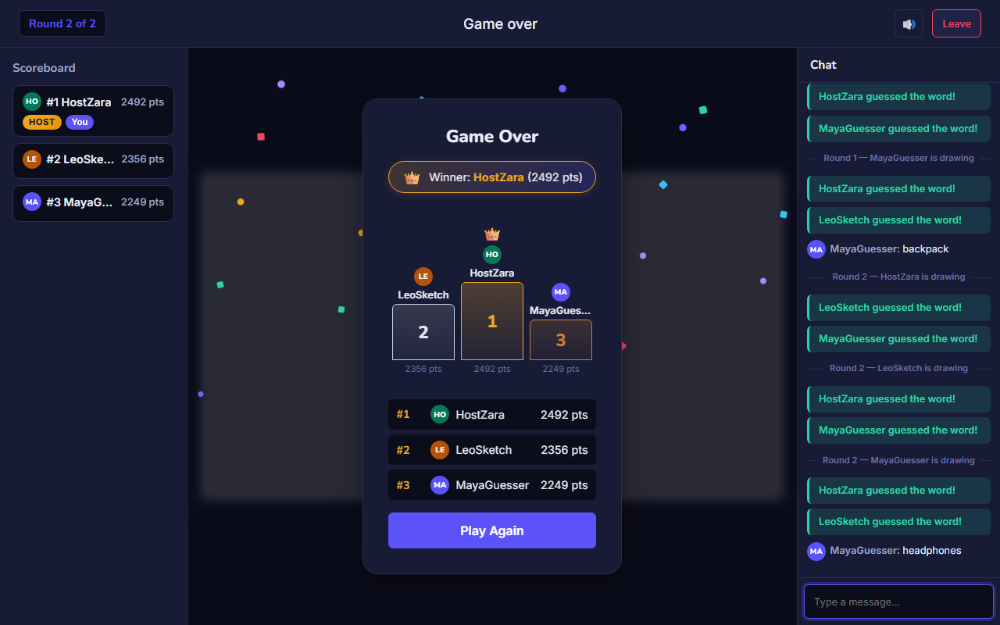
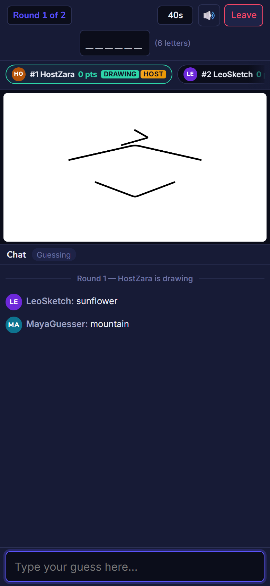
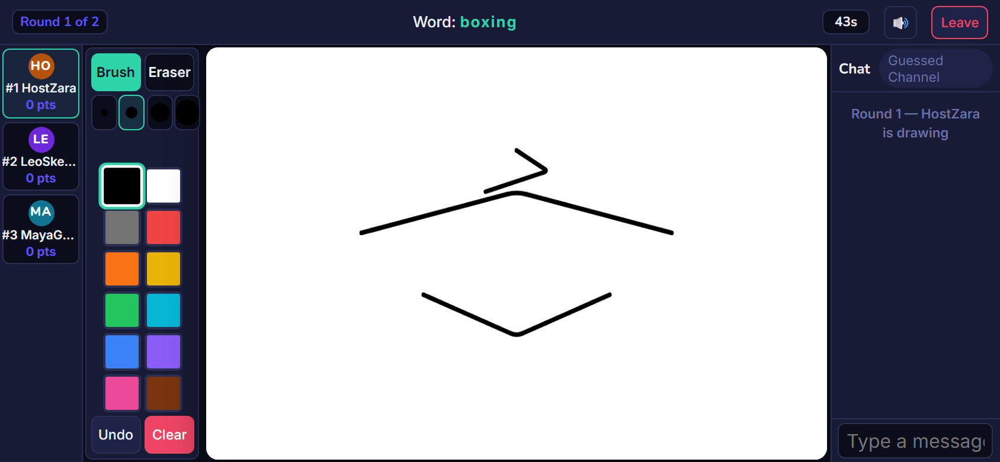
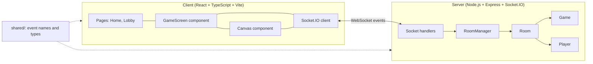
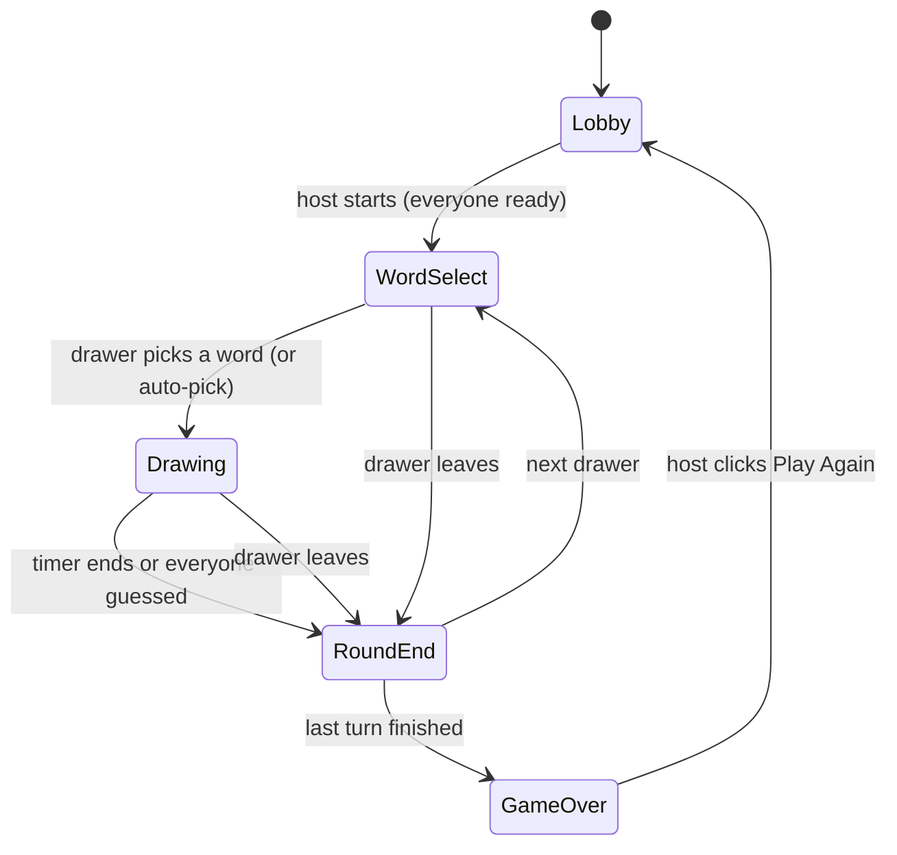
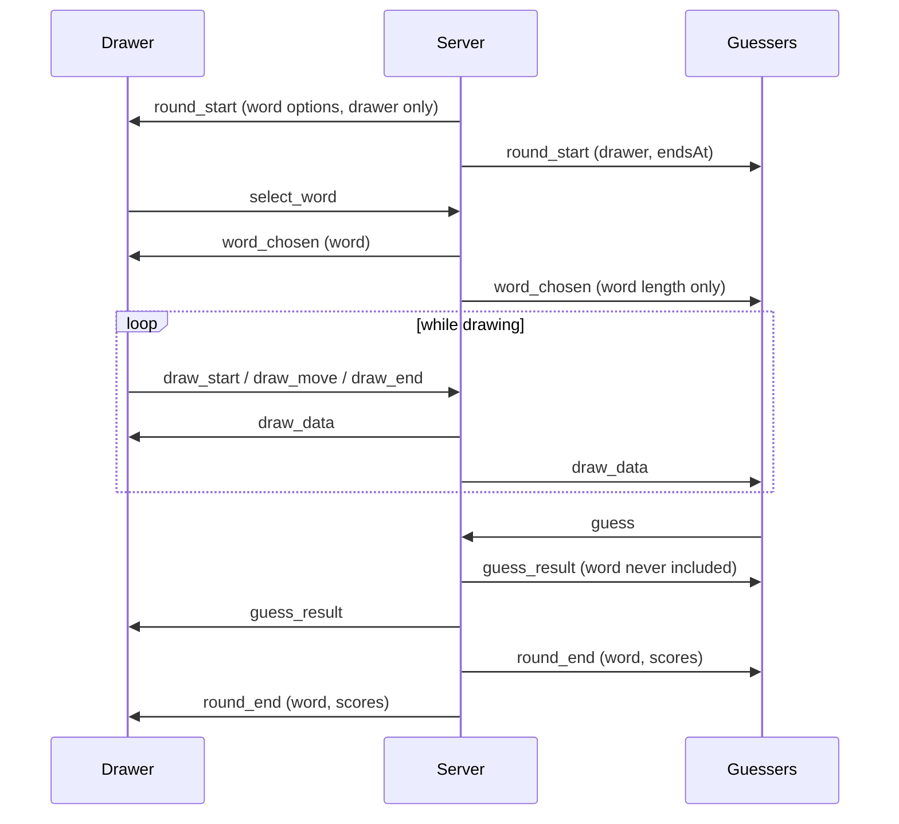

# 🎨 Skribbl Clone

[](https://nodejs.org/)
[](https://react.dev/)
[](https://www.typescriptlang.org/)
[](https://socket.io/)
[](https://render.com/)

**Live demo:** https://skribble-clone-d061.onrender.com

> The app runs on a free Render instance that sleeps when idle. The first load can take up to a minute.

---

## 📋 Overview

A real-time multiplayer drawing and guessing game for the browser, inspired by skribbl.io. Players join a room, take turns drawing a secret word, and the others race to guess it. Faster guesses score more points, and whoever leads after the last round wins.

Everything is synced over **Socket.IO**: strokes, guesses, chat, timers and game state. The **server is the single source of truth**. Clients only render what the server sends and submit intents, so the word, the timer and the score can't be tampered with from the browser.

It was built as a full-stack intern assignment: a React + TypeScript client, a Node.js + Express + Socket.IO server with an object-oriented game engine, and a shared package for types and event names.

---

## 🎨 Application Preview

### Home

*Quick Play, join by code, public rooms and room creation.*

### Lobby

*Ready-up, host controls, room settings and an invite link.*

### Drawing

*Live canvas with the drawing toolbar, hints, timer and chat.*

### Round End and Game Over



### Mobile
<p align="left">
  
  
</p>

---

## 🎯 Key Features

### 🏠 Rooms and Lobby
- **5-character room codes**, invite links (`/room/CODE`), and a public room list
- **Quick Play**: joins a random open public room, or creates one if none exists
- **Ready-up**: the host can only start once everyone is ready and at least 2 players are in
- **Host controls**: kick and ban (banned players can't rejoin with a new nickname), and editing custom words
- **Room settings**: players (2-20), rounds (2-10), draw time (15-240s), words to choose from (1-5), hints (0-5), word mode, public or private

### 🖌️ Drawing
- HTML5 canvas with **brush, eraser, 4 sizes, 12 colors, undo and clear**
- **Normalized 0-1 coordinates**, so a drawing looks the same on any screen size
- Pointer events: mouse, touch and pen go through the same code
- Strokes are validated and stored by the server, so late joiners and refreshed tabs get the full drawing back

### 🎮 Game Flow
- Every player draws once per round; the drawer picks 1 of N words (auto-picked after 15 seconds)
- **Hints** are revealed as masked text (`_ a _ _ e`) at evenly spaced times, never more than half the letters
- **Word modes**: Normal, Hidden (length not shown) and Combination (two-word phrases)
- **Custom words**: the host adds their own words (up to 100 words, 2-30 characters), mixed with default list or used exclusively
- Round ends when the timer runs out or everyone has guessed

### 💬 Guessing and Chat
- Case-insensitive, trimmed matching, plus a private "you're close!" message for guesses one letter off
- A message containing the secret word is blocked from the chat
- **Separate chat channels**: players who have guessed (and the drawer) chat privately, so nobody spoils the word
- Rate limiting on chat and guesses (max 5 per 2 seconds) and draw events (10ms throttle)

### 🔄 Reliability
- **Session rejoin**: refreshing the page or a short network drop doesn't remove a player from the game
- **30-second grace period** before a disconnected player is removed, with turn and host handling
- Host leaves: the next player becomes host. Drawer leaves: the turn is skipped

### 📱 Interface
- Responsive layout for desktop, phone portrait and phone landscape
- Generated avatars, timer color warnings, correct-guess sound (with a mute toggle), podium and confetti at game over
- Respects `prefers-reduced-motion`

---

## 🏗️ Architecture



### Server classes

| Class | Responsibility |
|-------|----------------|
| `Player` | Stable id, secret session token, current socket id, score, ready flag, connection state, grace timer |
| `Room` | Code, host, players, settings, bans, chat history, lobby state, per-player state snapshots |
| `RoomManager` | Creates and finds rooms, public room list, quick play, cleans up empty rooms |
| `Game` | Phases, turn order, timers, word selection, strokes, guess handling, hints, scoring |
| `handlers` | Validates every incoming socket event (sender role, phase, payload shape) |

### Game phases



### One turn, end to end



---

## 🔌 Real-Time Events

| Group | Events |
|-------|--------|
| Rooms | `create_room`, `join_room`, `rejoin_room`, `quick_play`, `player_joined`, `player_left`, `host_changed` |
| Lobby | `player_ready`, `update_settings`, `start_game`, `play_again`, `kick_player`, `kicked` |
| Game | `game_state`, `get_game_state`, `round_start`, `select_word`, `word_chosen`, `hint_update`, `timer`, `round_end`, `end_turn`, `game_over` |
| Drawing | `draw_start`, `draw_move`, `draw_end`, `draw_data`, `canvas_clear`, `draw_undo` |
| Chat | `guess`, `guess_result`, `chat`, `chat_message` |
| Other | `error` |

---

## 🧠 How It Works

**Drawing sync.** The drawer's pointer events become `draw_start` / `draw_move` / `draw_end` events with x and y in the 0-1 range. Moves are throttled on the server to 10ms intervals. The server checks that the sender is the current drawer, validates the payload, stores the stroke, and broadcasts `draw_data` to the whole room, including the drawer. Every client renders from the server's data, so everyone sees the same canvas, and strokes are scaled to each client's canvas size.

**Word secrecy.** The server never broadcasts raw state. Each socket gets its own payload: only the drawer receives the word options and the word, while guessers get the word length and a masked hint. The word is revealed to everyone only in `round_end`.

**Word matching.** A guess is trimmed, lowercased and has repeated spaces collapsed, then compared to the word. A guess within one edit (for words longer than 3 letters) triggers a private "close" message. Messages containing the secret word from players who haven't guessed yet are blocked so they cannot leak the word.

**Scoring.** Guesser points: `100 + 400 × (remainingMs / totalMs)`, plus a 50 point bonus for the first correct guess. The drawer earns 75 points per correct guesser. Ties at the end show all winners.

**Timers.** All timers run on the server. Clients receive an `endsAt` timestamp and count down locally, so a background tab or a slow device can't drift.

**Session rejoin.** Each player gets a secret token (kept in `sessionStorage`) and a stable id that is separate from the socket id. On reconnect the client sends `rejoin_room` with the token and the server restores the full state: phase, timer, strokes, hint, score and allowed chat history. The token is never included in broadcasts.

---

## 🛠️ Tech Stack

| Layer | Technology |
|-------|-----------|
| Frontend | React 19, TypeScript, Vite, plain CSS, React Router |
| Canvas | HTML5 Canvas API with normalized coordinate scaling |
| Backend | Node.js (20+), Express 4, TypeScript, Socket.IO 4 |
| Real-time | Socket.IO (WebSocket with polling fallback) |
| Build | tsup (server bundle), Vite (client bundle), npm workspaces |
| Testing | Node.js test runner (`node:test`) with tsx, Playwright for end-to-end tests |
| Hosting | Render (single web service) |

---

## 📖 Usage Guide

### 1. Prerequisites
- Node.js 20 or higher
- npm 10 or higher

### 2. Installation

```bash
git clone https://github.com/Ashmit76311/Skribble-Clone.git
cd Skribble-Clone
npm install
```

### 3. Environment Variables (optional)

Create `.env` files only if you want to override the defaults. See `.env.example`.

`server/.env`
```env
PORT=3001
CLIENT_URL=http://localhost:5173
```

`client/.env`
```env
VITE_SERVER_URL=http://localhost:3001
```

If `VITE_SERVER_URL` is empty, the client uses `http://localhost:3001` in development and the same origin in production.

### 4. Run in Development

```bash
npm run dev
```

- Client: http://localhost:5173
- Server: http://localhost:3001

Open the client in 2 or 3 tabs (one in a private window) to play against yourself.

### 5. Production Build

```bash
npm run build
npm start
```

The server serves the built client, the API and Socket.IO from one port (`PORT`, default 3001).

### 6. Tests

```bash
# Server unit and integration tests (from workspace root)
npm test

# Server tests specifically
npm test -w server

# End-to-end test against the live deployment (needs Playwright installed)
cd e2e
npm run test:live
```

---

## ☁️ Deployment

Deployed as **one Web Service on Render**. Express serves the compiled React app from `client/dist`, the REST endpoints and the Socket.IO server on the same port, so there are no CORS settings to manage in production.

| Setting | Value |
|---------|-------|
| Build command | `npm ci --include=dev && npm run build` |
| Start command | `npm start` |
| Environment | `NODE_ENV=production` |
| Health check path | `/health` |
| Instances | 1 (free tier) |

**Why not Vercel or Netlify for the backend?** WebSockets need a long-running server process. Vercel and Netlify run serverless functions that don't keep connections open, so a game server like this needs a platform such as Render or Railway.

---

## 📁 Repository Map

```
.
├── client/                 React frontend
│   └── src/
│       ├── pages/          Home.tsx, Lobby.tsx
│       ├── components/     GameScreen.tsx, Canvas.tsx, Avatar.tsx, Toast.tsx
│       ├── socket.ts       Socket.IO client setup
│       ├── audio.ts        Sound effects (Web Audio API)
│       ├── viewportFix.ts  iOS Safari orientation reset & debug panel
│       ├── App.tsx         Router setup
│       └── App.css         Design system, component styles & responsive layouts
├── server/                 Express and Socket.IO backend
│   ├── src/
│   │   ├── Game.ts         Turns, timers, guesses, scoring
│   │   ├── Room.ts         Players, settings, bans, chat history
│   │   ├── RoomManager.ts  Room lookup, quick play
│   │   ├── Player.ts       Player state, session token
│   │   ├── handlers.ts     Socket event handlers and validation
│   │   ├── wordMatching.ts Guess normalization and matching
│   │   ├── scoring.ts      Point calculation
│   │   ├── hints.ts        Hint masking and reveal schedule
│   │   └── index.ts        Express & Socket.IO server entry
│   ├── test/               Unit and integration tests (node:test)
│   └── words.json          Categorized word list
├── shared/                 Event names and TypeScript types shared by both sides
│   ├── events.ts           SocketEvent enum definitions
│   └── types.ts            Room, Player, GameState, and Socket payload types
├── e2e/                    Playwright end-to-end tests & screenshot script
├── docs/screenshots/       README preview screenshots
└── package.json            npm workspaces, build, start and test scripts
```

---

## 🔐 Security and Fair Play

- The server owns all game state; clients can't set scores, timers or words
- Every socket event is validated for sender role, game phase and payload shape
- Draw, chat and guess events are rate limited
- The secret word is only sent to the drawer, and to guessers after round end
- Session tokens are private to each player and are invalidated on kick or ban
- Bans use a per-browser device id. This stops casual rejoining, but clearing browser storage gets around it, since there are no accounts

---

## ⚠️ Known Limitations

- Rooms, games and sessions live in server memory. A restart or redeploy clears them.
- Built for a single server instance. Running several would need a shared adapter such as Redis for Socket.IO and game state.
- The free Render tier sleeps when idle, so the first request after a pause is slow.
- Bans are soft (device-based), not account-based.

---

## 🚀 Future Improvements

- Redis adapter for horizontal scaling
- Spectator mode and replay of the last drawing
- Votekick and player reports
- More word languages
- Fill-bucket tool and a color picker
- Player accounts with persistent stats

---

## 👤 Author

**Ashmit Kumar Srivastav**
- GitHub: [@Ashmit76311](https://github.com/Ashmit76311)
- Project: [Skribbl Clone](https://github.com/Ashmit76311/Skribble-Clone)
